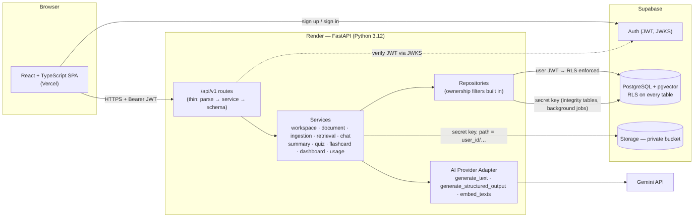

# StudyPilot AI — Cloud-based AI Study & Research Assistant

Upload your course materials, ask questions and get **answers grounded in your own documents with page-level sources**,
then practise with **auto-graded quizzes** and **flashcards**, and track progress on a dashboard.

**Live demo:** _add your Vercel URL here_ · **API docs:** _add your Render URL_/docs · **Demo video:** _add link_



## Features

| | |
|---|---|
| **Auth & privacy** | Supabase Auth (sign up, sign in, password reset, profile). Every table protected by PostgreSQL Row Level Security; files in a private bucket. |
| **Workspaces** | One per course. Deleting one removes its documents, files, vectors, chats, quizzes and flashcards. |
| **Documents** | PDF, DOCX, TXT, Markdown ≤ 20 MB. Extension + MIME + file-signature validation, duplicate detection (SHA-256), background processing with visible status and failure reasons. |
| **RAG chat** | Question → embedding → pgvector search scoped to *your* workspace → Gemini answer with `[S1]` citations. Citations the model invents are removed; if your materials don't cover a question, it says so instead of guessing. |
| **Summaries** | 8-section revision summary built map-reduce style (long documents are never sent in one prompt), cached. |
| **Quizzes** | Multiple choice, true/false, short answer. Model JSON is validated with Pydantic and business rules before saving; auto-grading with explanations and links to the source passage. |
| **Flashcards** | Generated from your notes, flip to reveal, mark Learning/Mastered, review history, "cards to review" list. |
| **Dashboard** | Workspaces, documents, study sessions, quizzes, average score, cards to review, recent activity and charts — all from the database. |
| **Cost control** | Per-user daily AI quota, rate limits, input/output caps, embedding reuse, summary cache, bounded retries, usage & estimated-cost tracking, Mock AI provider. |

## Tech stack

**Frontend:** React 19, TypeScript, Vite, Tailwind CSS v4, React Router, TanStack Query, Recharts, supabase-js — deployed on **Vercel**.
**Backend:** Python 3.12, FastAPI, Pydantic v2, google-genai, supabase-py, PyJWT (JWKS), pypdf, python-docx — deployed on **Render**.
**Data:** Supabase PostgreSQL + **pgvector**, Supabase Auth, Supabase Storage, RLS.
**AI:** Gemini API behind a provider adapter (`generate_text`, `generate_structured_output`, `embed_texts`); `gemini-embedding-001` at 768 dimensions.
**Quality:** Pytest + HTTPX, Vitest + React Testing Library, Playwright, Ruff, oxlint, GitHub Actions CI.

## Architecture in one paragraph

A modular monolith. The SPA authenticates with Supabase and calls the FastAPI backend with the user's JWT. The backend verifies
the token against Supabase's public JWKS, then reads data **with that same JWT** so Postgres RLS is enforced, and uses the secret key
only for tables users must not write directly (scores, usage, activity) and for background document ingestion. Business logic lives
in services; repositories add owner filters to every query; all AI calls go through one adapter, so the provider can be swapped or
mocked. Details and design trade-offs: [docs/architecture.md](docs/architecture.md).

## Repository layout

```
backend/            FastAPI app (app/), tests (tests/), RAG evaluation (eval/)
frontend/           React app (src/), Playwright E2E (e2e/)
supabase/           migrations/ (schema, RLS, storage, match_chunks), tests/ (SQL RLS check), seed.sql
sample_data/        original course notes for demos and evaluation
docs/               SRS, architecture, database (ER), API, privacy, deployment, testing, demo script, diagrams
render.yaml         Render blueprint · .github/workflows/ci.yml  CI
```

## Run locally (macOS, 8 GB RAM is enough — no Docker, no local database, no local models)

Prerequisites: `brew install git uv supabase/tap/supabase`, Node LTS, a Supabase **dev** project and (optionally) a Gemini API key.
Full instructions, including Supabase setup: [docs/deployment.md](docs/deployment.md).

```bash
git clone https://github.com/<you>/studypilot-ai.git && cd studypilot-ai

# 1) Database schema → your Supabase dev project
supabase login && supabase link --project-ref <ref> && supabase db push

# 2) Backend  → http://localhost:8000/docs
cd backend
cp .env.example .env          # fill SUPABASE_* ; keep AI_PROVIDER=mock until you add GEMINI_API_KEY
uv sync
uv run uvicorn app.main:app --reload

# 3) Frontend → http://localhost:5173
cd ../frontend
cp .env.example .env.local    # VITE_SUPABASE_URL, VITE_SUPABASE_PUBLISHABLE_KEY, VITE_API_BASE_URL=http://localhost:8000
npm install
npm run dev
```

## Tests

```bash
cd backend  && uv run pytest -q                 # 76 passed (+7 live-Supabase tests skipped without credentials)
cd frontend && npm test                         # 10 passed
cd frontend && npx playwright test e2e/smoke.spec.ts   # 8 passed (desktop + mobile)
cd backend  && AI_PROVIDER=gemini GEMINI_API_KEY=… uv run python -m eval.run_eval   # 26-question RAG evaluation
```

Report, coverage of each requirement and the SQL RLS verification: [docs/testing.md](docs/testing.md).

## Documentation

[SRS](docs/SRS.md) · [Architecture](docs/architecture.md) · [Database & ER diagram](docs/database.md) · [API](docs/API.md) ·
[Privacy & security](docs/privacy.md) · [Deployment](docs/deployment.md) · [Testing](docs/testing.md) · [Demo script](docs/demo-script.md)

## Limitations & honest notes

* Free tiers: Render free instances sleep after 15 min (first request can take ~1 min — the UI shows a "waking up" banner);
  Supabase free projects pause after 7 days of inactivity; Gemini free-tier content may be used by Google to improve products —
  **upload only public or self-made material**.
* No OCR for scanned PDFs; no spaced-repetition algorithm yet (simple NEW/LEARNING/MASTERED states).
* RAG quality numbers are only meaningful after running `eval/run_eval.py` with Gemini; see docs/testing.md.

## License

MIT — see [LICENSE](LICENSE). Sample notes in `sample_data/` are original and may be reused.
