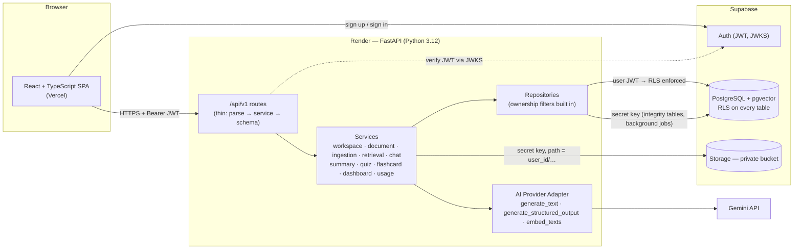
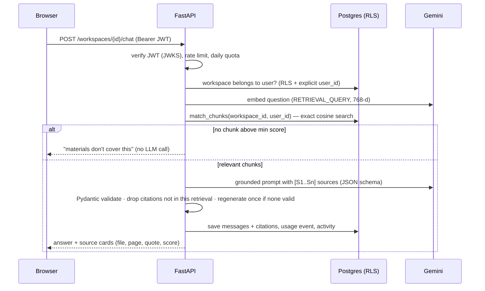

# Architecture

StudyPilot AI is a **modular monolith**: one React SPA, one FastAPI service, and managed cloud services.
No microservices, no queues, no Kubernetes — every moving part is something a single developer can run and debug.

## System diagram



## Request lifecycle (example: chat)



## Key design decisions

| Decision | Why | Trade-off |
|---|---|---|
| **Modular monolith** (FastAPI + services/repositories) | One deployable, easy to debug on an 8 GB laptop | Scales vertically only — fine for this workload |
| **Backend reads DB with the user's JWT** (`postgrest.auth(token)`) | RLS really protects data, not just "is enabled" | One Supabase client per request (cheap HTTP client) |
| **Secret key only for integrity tables + background ingestion** | Users must not be able to forge quiz scores or reset AI quota through the public PostgREST API | Those code paths must filter `user_id` explicitly — covered by tests |
| **JWT verification via JWKS (ES256/RS256)** | Supabase's current asymmetric signing keys; no shared secret on the server | First request fetches the key set (cached 1 h) |
| **Embeddings: `gemini-embedding-001`, 768 dimensions, L2-normalised** | Default 3072-d exceeds pgvector's 2,000-d index limit; 768 is an officially recommended size; truncated output must be normalised | Changing model/dimension requires re-embedding everything |
| **Exact (filtered) vector search, no HNSW yet** | Every query filters by workspace; HNSW applies filters *after* the graph search and can return too few rows | Linear scan per workspace — fast at study-material scale; add HNSW + iterative scan later |
| **Background ingestion with FastAPI `BackgroundTasks`** | No worker service needed (Render free tier has no free workers) | A restart can interrupt processing → status stays `PROCESSING`; user can **Reprocess** after 10 min |
| **Map-reduce summaries** | Long documents never go into one prompt | More calls per summary → result is cached in `document_summaries` |
| **Structured output + Pydantic re-validation + business validation** | Model output is never trusted (JSON shape, MCQ has 4 distinct options, answer ∈ options, sources exist) | Invalid questions are discarded, so a quiz can have fewer questions than requested |
| **Mock AI provider** | Develop and test without network or quota; deterministic tests | Mock answers are not realistic text |
| **Daily quota in the database, rate limit in memory** | Quota survives restarts; per-minute limit is cheap | In-memory limiter is per-instance (fine with one instance) |

## Backend layout

```
backend/app/
  main.py               app factory: CORS allowlist, error handlers, router
  api/deps.py           Ctx: current user, user-scoped DB, admin DB, storage, AI provider
  api/v1/routes.py      all endpoints (thin)
  core/                 config (env), security (JWKS), errors (envelope), rate_limit, logging (secret redaction)
  db/                   Gateway protocol + Supabase and in-memory implementations
  repositories/         TableRepo with owner filtering; one repo per table
  services/             business logic (no FastAPI imports except via Ctx)
  providers/            base (interface), gemini, mock
  parsers/              PDF (pypdf), DOCX (python-docx), Markdown, TXT + file-type detection
  schemas/              api.py (request/response), ai.py (LLM output schemas)
```

## Frontend layout

```
frontend/src/
  app/          router (code-split per feature), AppLayout (sidebar, mobile menu, "server waking" banner)
  components/   ui primitives (Button, Card, Dialog, states), Markdown (safe renderer with citation chips)
  features/     auth · landing · workspaces · documents · chat · quiz · flashcards · progress · settings
  hooks/        TanStack Query hooks for every endpoint (polling while documents process)
  lib/          api client (JWT, error envelope, timeouts), supabase client, utils
  types/        API types mirroring backend schemas
```
