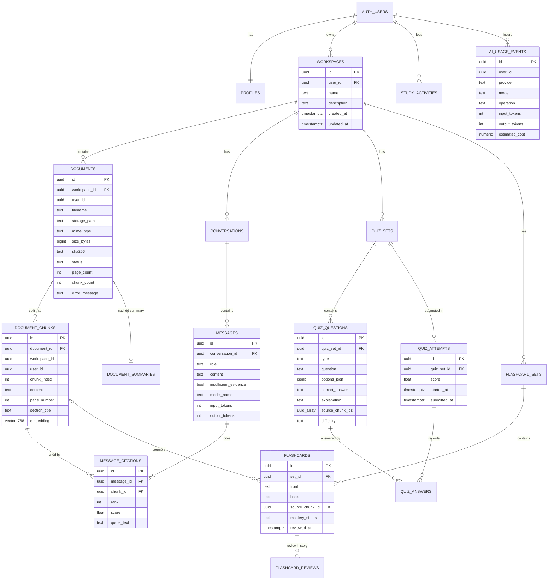

# Database Design

PostgreSQL on Supabase with the `pgvector` extension. Schema: [`supabase/migrations/20261111000001_initial_schema.sql`](../supabase/migrations/20261111000001_initial_schema.sql).

## ER diagram

## Tables

| Table | Purpose | Notes |
|---|---|---|
| `profiles` | Display name per auth user | Created automatically by trigger `on_auth_user_created` |
| `workspaces` | One per course/topic | `updated_at` trigger |
| `documents` | Uploaded file metadata + processing status | `UNIQUE (workspace_id, sha256)` = duplicate detection; `status ∈ UPLOADED/PROCESSING/READY/FAILED` |
| `document_chunks` | Text chunks + `vector(768)` embeddings | Page number and section title kept for citations |
| `document_summaries` | Cached map-reduce summary (JSONB) | One per document |
| `conversations`, `messages`, `message_citations` | Chat history with verified sources | Citation always references a real chunk (FK) |
| `quiz_sets`, `quiz_questions` | Generated quizzes | `source_chunk_ids uuid[]` links each question to material |
| `quiz_attempts`, `quiz_answers` | Scores and graded answers | **Read-only for users** (written by backend) |
| `flashcard_sets`, `flashcards`, `flashcard_reviews` | Cards, mastery status, review history | `source_chunk_id ON DELETE SET NULL` |
| `study_activities` | Activity log for Dashboard "study sessions" and "recent activity" | Read-only for users |
| `ai_usage_events` | Every AI call: model, operation, tokens, estimated cost | Read-only for users; drives the daily quota |

Every child table carries `user_id`, so each RLS policy is a simple `user_id = auth.uid()` with no joins.

## Indexes

Foreign keys used for listing (`workspace_id`, `document_id`, `conversation_id`, `quiz_set_id`, `set_id`) are indexed together with
the sort column (`created_at`/`position`/`chunk_index`). Time-based queries (`ai_usage_events (user_id, created_at)`,
`study_activities (user_id, created_at)`) have composite indexes for the daily quota and dashboard.

**Vector index:** none in V1, on purpose. Retrieval always filters by `workspace_id` (B-tree indexed) and then sorts by
cosine distance over that workspace's chunks — exact and fast at study-material scale. HNSW applies `WHERE` filters after the
approximate search, which can return fewer than *k* rows for selective filters. When a workspace grows beyond tens of thousands
of chunks, add `CREATE INDEX ... USING hnsw (embedding vector_cosine_ops)` and enable pgvector's iterative index scans.

## Embedding dimension

`gemini-embedding-001` outputs 3,072 dimensions by default, but pgvector indexes `vector` columns only up to 2,000 dimensions.
The backend requests `output_dimensionality=768` (an officially recommended size), normalises the vectors, and the column is
`vector(768)`. The backend rejects any embedding whose length differs from `EMBEDDING_DIM`. Changing model or dimension
requires a new migration **and** re-embedding all documents (embedding spaces are not compatible).

## Row Level Security

* **Content tables** — owner may `SELECT/INSERT/UPDATE/DELETE` rows where `user_id = auth.uid()`.
* **Restrictive insert policies** — a document/conversation/quiz/flashcard set can only be attached to a workspace the user owns.
* **Integrity tables** (`quiz_attempts`, `quiz_answers`, `study_activities`, `ai_usage_events`) — `SELECT` only. The backend writes
  them with the secret key and explicit `user_id`, so a user holding the public key cannot forge a score or erase their quota.
* **Storage** — bucket `documents` is private; object paths are `{user_id}/{workspace_id}/{document_id}/{filename}` and storage
  policies only allow the folder that matches `auth.uid()`.
* **`match_chunks`** is `SECURITY INVOKER`, so RLS applies inside the vector search as well.

Verification: `supabase/tests/10_rls_check.sql` (runs in CI on Postgres 16 + pgvector) and
`backend/tests/integration/test_rls_live.py` (against your real Supabase project).

## Deletion and cleanup

`ON DELETE CASCADE` from `auth.users → workspaces → documents → document_chunks → message_citations` (and the other children)
removes rows and vectors. Storage objects are **not** covered by SQL cascades, so the services delete files explicitly before
deleting a document, a workspace, or an account.
